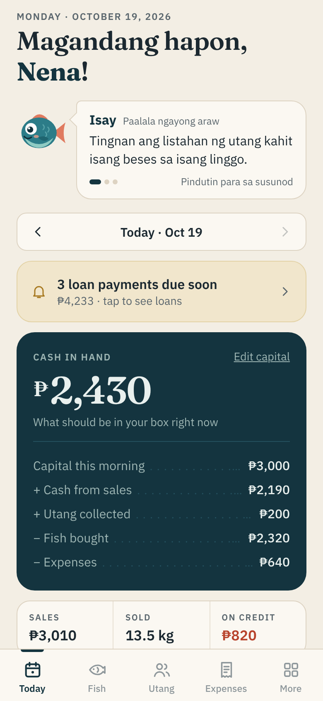
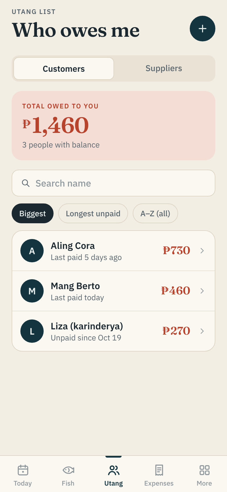
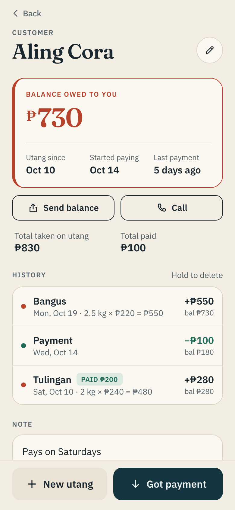
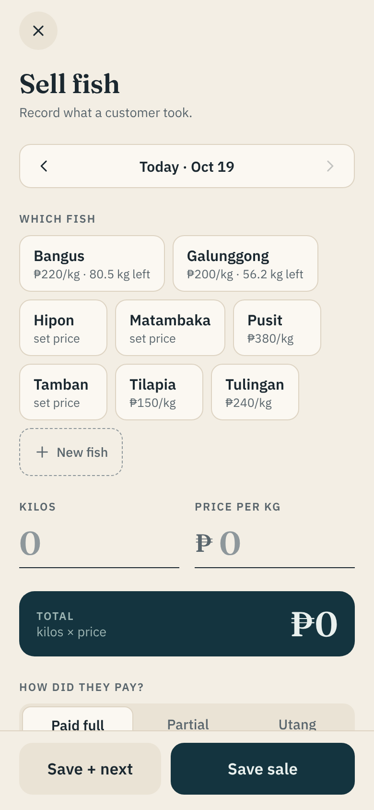
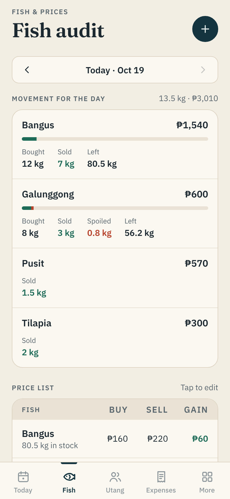
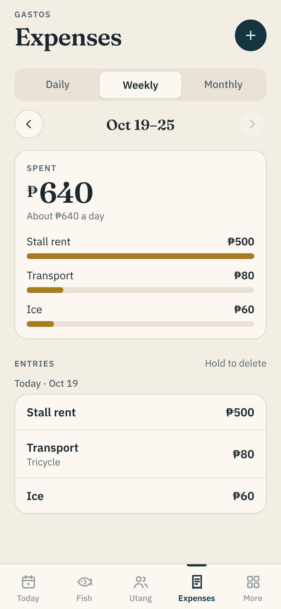
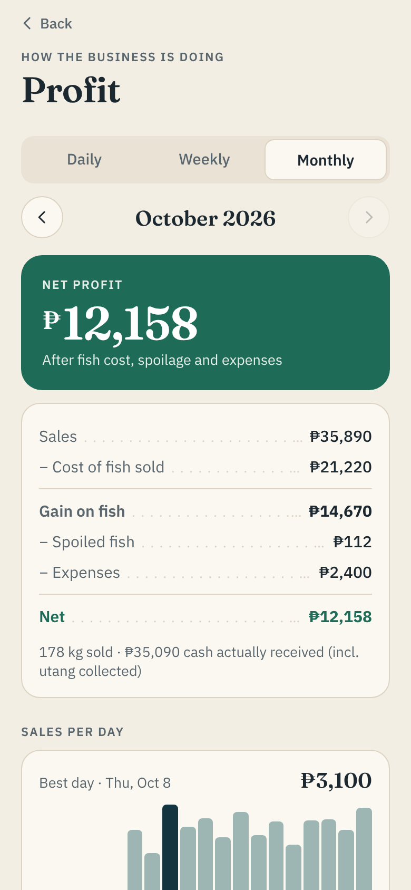
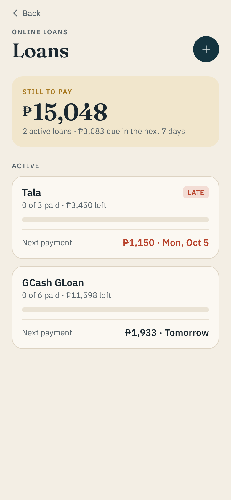

# Fish Ledger

A notebook-ledger app for a market fish vendor. It runs on her phone with no
account and no internet: everything is stored in a SQLite file on the device.

## What it does

| Tab | What she uses it for |
|---|---|
| **Today** | Greeting ("Good morning, Ma!") and Yuki the Siamese cat's Tagalog *paalala ngayong araw* (a new tip each day, plus reminders from her own records). Today's capital (puhunan), cash that should be in the box, sales, kilos sold, sales on credit. Quick buttons for **Sell fish**, **Buy stock**, **Got payment**, **Expense**, **Spoiled**. **Close the day**: count the cash and see if anything is missing. |
| **Fish** | Daily fish audit: kilos bought, sold, spoiled and left per fish. Price list with buy cost, selling price and gain per kilo. |
| **Utang** | Customers who owe her, and suppliers she owes. Each person shows their balance, utang since, the date they started paying, last payment, and the full history (fish, kilos × price = total, payments) with a running balance. Send a statement by Messenger/SMS, or call. |
| **Expenses** | Daily / weekly / monthly totals by category (ice, transport, bags, rent…). |
| **More** | **Online loans** (GLoan, SLoan, Tala, Home Credit…) with a payment schedule and phone reminders the day before and on each due date. **Profit** report: sales − cost of fish − spoilage − expenses, best sellers, sales per day. **Settings**: names, PIN lock, 6 AM morning paalala, backup/restore. |

Sales can be **paid full**, **partial**, or **utang** — the unpaid part goes to
that customer's balance automatically. Stock bought from suppliers works the same
way.

## Run it

```bash
npm install
npm run android        # Expo dev server; open on the phone
npm run web            # browser preview
```

Notifications, SecureStore and the PIN need a real build. To install it on her
phone as an APK:

```bash
npx eas-cli@latest login
npm run build:apk      # EAS builds an APK and gives a download link
```

## Develop

```bash
npm run typecheck
npm run lint
```

In the web preview (development only) run `await seedDemo()` in the browser
console on an empty database to fill two weeks of sample records.

Money is stored as integer centavos, weights as kilograms. The schema and every
query live in `src/lib/db.ts`; screens are in `src/app` (Expo Router).

## Screens

| Today | Utang | A customer | Sell fish |
|---|---|---|---|
|  |  |  |  |

| Fish audit | Expenses | Profit | Loans |
|---|---|---|---|
|  |  |  |  |
